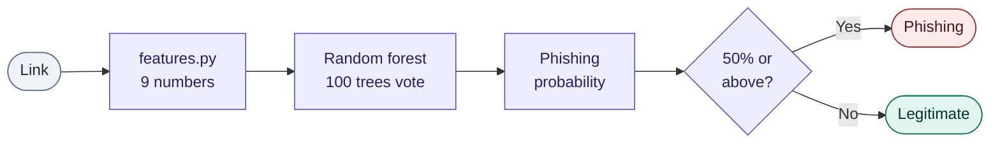
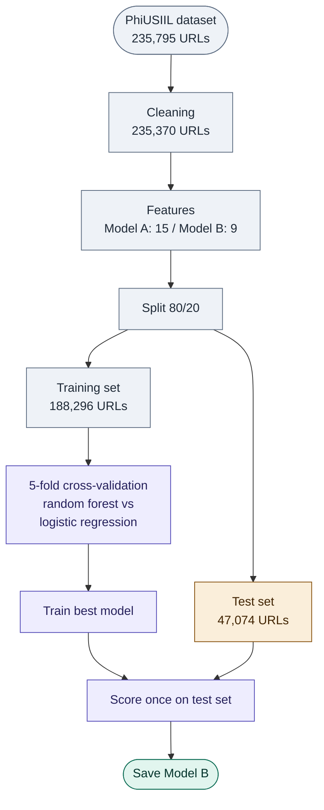

# Phishing URL Classifier

I will refer to Machine Learning as ML in this description.

This is a simple phishing URL classifier. It takes a link and evaluates it from 0–100% on the likelihood of phishing. 0–49% results in a "legitimate" verdict, and 50–100% in a "phishing" verdict.

The classifier uses a random forest model with 100 trees and 9 features. The model scored an honest 94.1% accuracy on 47,074 test links it never saw during training.

The first iteration of the model had an unbelievable 99.6% score, which it achieved by exploiting a shortcut in the dataset. So I built a second model. Model A is the first iteration, and Model B is the second.

There are some major pitfalls in this classifier. The scope of this classifier is to only read the protocol and domain name. It does not visit the page, does not check blocklists, and does not catch look-alike domains of famous brands (typosquatting and homoglyphs). This leaves plenty of room for improvement, which I return to later.

## Purpose

The purpose of this project was always to help me learn more about ML, as I aspire to become knowledgeable and proficient in the field of ML and AI. That is also the reason why there are plenty of possibilities to improve the model, as described under [Improvements](#improvements).

## How it works

The classifier never opens the website. It only reads the link text, turns it into 9 numbers and lets 100 decision trees vote:



For example, for `https://www.paypa1.com`, only 37% of the trees voted "phishing", so a fake PayPal domain slipped through as "legitimate". This is one of the pitfalls covered under [Results](#results-and-final-verdict).

## Model choice

I chose the random forest algorithm because it is relatively simple and worked well on the dataset. My model uses supervised learning (it learned from labelled examples) and binary classification, as the final verdict is either "legitimate" or "phishing".

## Method

From the raw data to the final result, the project went through these seven steps:

1. **Cleaning:** removed 425 duplicate URLs and an unused `FILENAME` column. Duplicates were removed before splitting, so no website appears in both the training and the test set.
2. **Exploration:** charts revealed two quirks. Every legitimate URL uses HTTPS (vs 49% of phishing URLs), and 0.0% of legitimate URLs have anything after the domain (vs 28.4% of phishing URLs). The legitimate URLs are all bare homepages.
3. **Feature sets:** Model A uses the dataset's own 15 URL features. Model B uses 9 features I calculate myself from only the protocol and domain (`features.py`). This removes the "has a path" issue.
4. **Split:** the data was split 80/20 into a training set and a test set with scikit-learn's `train_test_split`. The split is stratified (same phishing/legitimate ratio in both parts) and uses `random_state=42`, so the results are reproducible.
5. **Model selection:** logistic regression and random forest were compared with 5-fold cross-validation on the training set only. For Model B, random forest won with 94.0% against 90.8%.
6. **Final test:** the best model for each feature set was trained on the full training set and scored once on the untouched test set.
7. **Saving and use:** Model B was saved with `joblib`, and `check_url.py` loads it to check any link.



## Results and final verdict

| Model | Features used | Test accuracy |
|---|---|---|
| A | The dataset's 15 URL features | 99.6% |
| B | My 9 domain-only features | 94.1% |

Model A looks better, but its score is inflated by data leakage. It learned "URL with a path = phishing", which only works because every legitimate URL in the dataset is a bare homepage. Model B ignores everything after the domain, so its 94.1% is the honest number.

| Model B | Precision | Recall |
|---|---|---|
| Phishing | 97.4% | 88.6% |
| Legitimate | 92.0% | 98.3% |

When Model B gives the verdict "phishing", it is right 97.4% of the time (precision). It catches 88.6% of real phishing links (recall), and the remaining 11% are false negatives: phishing links labelled as safe. This means the model is careful about calling a link phishing, and its mistakes mostly lean towards letting phishing through, which is the more dangerous mistake for a security tool. The cross-validation score (94.0%) matches the test score of Model B (94.1%), which means the model is not overfitting.

Almost half of every decision (48%) depends on `is_https`. Since every legitimate URL in the dataset uses HTTPS, the model treats "no HTTPS" as near-proof of phishing.

### Testing on hand-picked links

| Link | Truth | Model B verdict | Phishing probability |
|---|---|---|---|
| `https://docs.google.com/document/d/abc123` | legitimate | ✅ legitimate | 11% |
| `https://login.microsoftonline.com` | legitimate | ✅ legitimate | 8% |
| `https://paypal-secure-login-2847.xyz` | phishing | ✅ phishing | 100% |
| `http://192.168.4.21/login` | phishing | ✅ phishing | 100% |
| `https://apple-id.verify-account-support.com` | phishing | ✅ phishing | 82% |
| `https://secure-paypal.com` | phishing | ✅ phishing | 100% |
| `https://www.arnazon.com` | phishing | ❌ legitimate | 11% |
| `https://www.paypa1.com` | phishing | ❌ legitimate | 37% |

### Final verdict

I am overall pleased with the result and its limited real-world application. Model B catches most phishing links and rarely raises false alarms. But the feature importance and the hand tests show its two main pitfalls: it over-trusts HTTPS, and it cannot recognise look-alike brand domains like `paypa1.com`. It only counts characters and never reads what the domain says.

Summed up: the model is a good first filter, but it is not suited for a complete security check before opening a link.

## Improvements

There are still plenty of improvements to be made on the model, e.g.:

- Checking for brand similarity, to catch phishing that uses typosquatting and homoglyph attacks.
- Looking for suspicious keywords, such as login, verify and secure.
- A better dataset that contains legitimate URLs with full paths, and some without HTTPS. This would remove the model's over-reliance on HTTPS.
- Checking domain age and blocklists, which would also be a useful addition to the model.

## What I learnt

This project has been extraordinarily instructive for my learning in ML. This is my first project, and I started with zero prior experience with ML. I have learnt a lot about the basics of ML, as well as pitfalls that can occur with different models, such as shortcut learning and over-reliance on a single feature. Furthermore, I became better at prompt engineering as I did the project.

Some lessons I learnt:

- Beware of very high scores. They can be a sign of overfitting, data leakage, a weakness in the model's features, or a flawed dataset.
- Keep the test set truly unseen by removing duplicates before splitting the dataset, and compare the models on the training set only.
- Accuracy alone hides the trade-off between precision and recall.

## Deep dive

### Tools

This project is built using Python in collaboration with Claude (Anthropic). It uses scikit-learn for the random forest algorithm, pandas for handling the data, matplotlib for the charts and joblib for saving the model. The dataset is from the UCI Machine Learning Repository.

### Dataset

As mentioned above, the dataset is from the [UCI Machine Learning Repository](https://archive.ics.uci.edu/dataset/967/phiusiil+phishing+url+dataset):

> Prasad, A. & Chandra, S. (2024). *PhiUSIIL Phishing URL (Website)* [Dataset]. UCI Machine Learning Repository. https://doi.org/10.1016/j.cose.2023.103545

The dataset contains 235,795 URLs (134,850 legitimate and 100,945 phishing) and is licensed CC BY 4.0. Label 1 means legitimate, and 0 means phishing. After cleaning:

- 235,370 URLs after removing 425 duplicates
- Training set: 188,296 URLs / 80%
- Test set: 47,074 URLs / 20% / never seen during training

The dataset also has its own quirks, which partially explain Model B's over-reliance on the `is_https` feature. All the legitimate links in the dataset use the HTTPS protocol, which is important to take into account.

### Features

I built 9 features to input into the algorithm. The first model I built (Model A) used the dataset's own 15 URL features instead. It relied on a shortcut in the data, which resulted in a misleading 99.6% accuracy. Therefore, I made a second model (Model B) with my own 9 features, which avoids that shortcut. However, the model still uses certain features more than others.

The most important is the `is_https` feature, which Model B relies on for 48% of its decisions. The feature checks whether the protocol is HTTPS or not. The other features are `num_digits`, `digit_ratio`, `domain_length`, `num_dots`, `num_subdomains`, `num_hyphens`, `tld_length` and `is_ip_address`. The features are fairly self-explanatory, but here is the full library of the features and their exact function:

| Feature | What it measures | Importance |
|---|---|---|
| `is_https` | Does the link use HTTPS (1) or not (0)? | 48% |
| `num_digits` | Number of digits in the domain | 12% |
| `digit_ratio` | Share of the domain that is digits | 10% |
| `domain_length` | Number of characters in the domain | 10% |
| `num_dots` | Number of dots in the domain | 7% |
| `num_subdomains` | Number of parts before the main domain | 7% |
| `num_hyphens` | Number of hyphens in the domain | 4% |
| `tld_length` | Length of the ending, e.g. `.com` = 3 | 2% |
| `is_ip_address` | Is the domain a raw IP address? | 0% |

### How to run it

1. Download `PhiUSIIL_Phishing_URL_Dataset.csv` from the [UCI Machine Learning Repository](https://archive.ics.uci.edu/dataset/967/phiusiil+phishing+url+dataset) and place it in a `data/` folder.
2. Create a virtual environment and install the packages:

    ```bash
    python3 -m venv .venv
    source .venv/bin/activate
    pip install -r requirements.txt
    ```

3. Train the models (saves Model B to `models/`):

    ```bash
    python3 train.py
    ```

4. Check any link:

    ```bash
    python3 check_url.py
    ```
